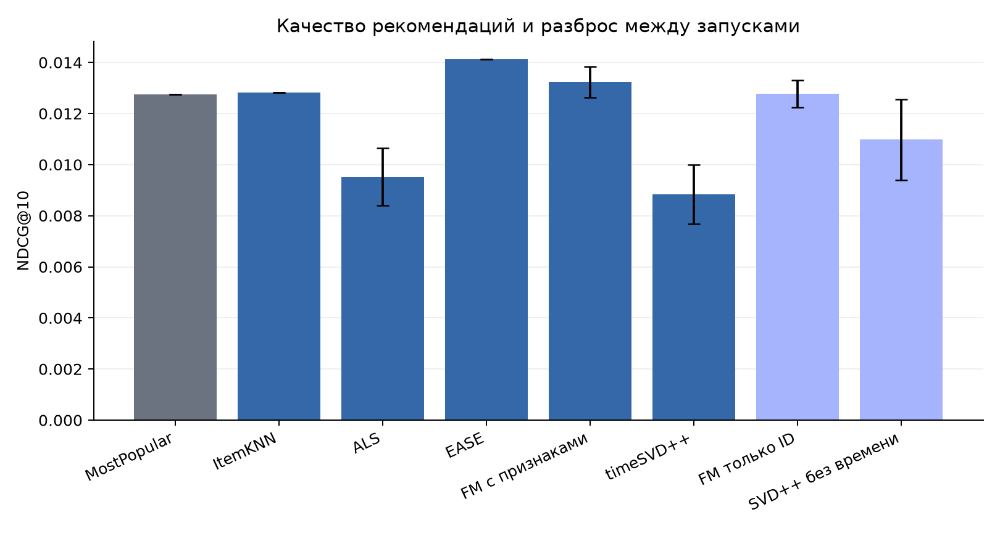
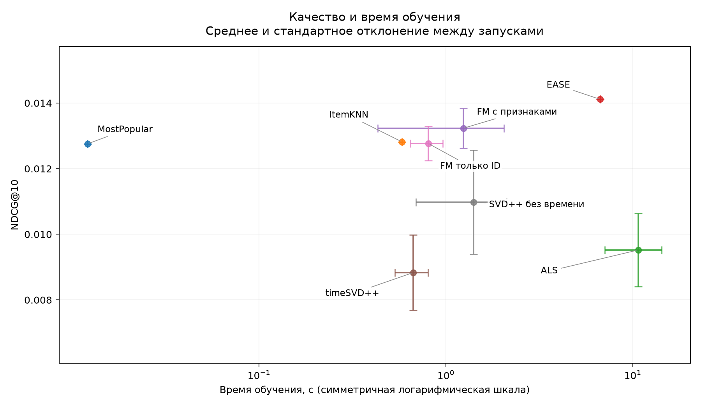

# Сравнение рекомендаций Amazon Musical Instruments 2018

ItemKNN, ALS для явных оценок, EASE, FM с метапризнаками и timeSVD++. Для сравнения добавлены MostPopular, FM только с ID и SVD++ без времени.

## Данные и протокол

После очистки: 153324 взаимодействий, 17702 пользователей и 7329 товаров. Из обучающей части по очереди удаляются пользователи и товары с менее чем 5 взаимодействиями. Для повторной пары пользователь-товар остаётся первое событие.

| Часть | Взаимодействия | Пользователи с положительной оценкой |
| --- | --- | --- |
| Обучение | 144036 | 17667 |
| Проверка | 5547 | 2330 |
| Тест | 3741 | 1702 |

Обучение до 2017-04-17, проверка от 2017-04-17 до 2017-12-08, тест с 2017-12-08. Даты в UTC. События одного дня остаются вместе. Параметры и число эпох подбираются на проверочной части, затем модель обучается на двух частях вместе.

Основные метрики считаются по 1702 пользователям с будущей оценкой ≥ 4 внутри каталога. Для каждого ранжируется весь каталог из 7329 товаров за вычетом всех уже оценённых товаров, включая оценки 1-3. Выбирается 10 рекомендаций. При равных оценках первым идёт меньший ID товара. Если персонального сигнала нет, используются популярные товары.

## Результаты

Среднее ± стандартное отклонение запусков. Модели без случайной инициализации запущены один раз, для них отклонение записано нулём.

| Модель | Запуски | NDCG@10 | Recall@10 | Precision@10 | MAP@10 |
| --- | --- | --- | --- | --- | --- |
| MostPopular | 1 | 0.01276 ± 0.00000 | 0.01822 ± 0.00000 | 0.00664 ± 0.00000 | 0.00945 ± 0.00000 |
| ItemKNN | 1 | 0.01282 ± 0.00000 | 0.02007 ± 0.00000 | 0.00529 ± 0.00000 | 0.00840 ± 0.00000 |
| ALS | 3 | 0.00952 ± 0.00112 | 0.01479 ± 0.00229 | 0.00360 ± 0.00038 | 0.00637 ± 0.00071 |
| EASE | 1 | 0.01411 ± 0.00000 | 0.02507 ± 0.00000 | 0.00570 ± 0.00000 | 0.00845 ± 0.00000 |
| FM с признаками | 3 | 0.01323 ± 0.00060 | 0.01893 ± 0.00075 | 0.00680 ± 0.00015 | 0.00943 ± 0.00060 |
| timeSVD++ | 3 | 0.00883 ± 0.00115 | 0.01279 ± 0.00079 | 0.00409 ± 0.00014 | 0.00519 ± 0.00132 |
| FM только ID | 3 | 0.01277 ± 0.00053 | 0.01856 ± 0.00102 | 0.00642 ± 0.00037 | 0.00883 ± 0.00042 |
| SVD++ без времени | 3 | 0.01097 ± 0.00159 | 0.01657 ± 0.00241 | 0.00541 ± 0.00077 | 0.00714 ± 0.00152 |

Лучшее среднее NDCG@10 на тесте у EASE: 0.01411.

## Парные сравнения

Основное сравнение: timeSVD++ минус ALS. Метрики каждого пользователя усредняются по запускам. Затем 2000 раз одни и те же пользователи выбираются с возвращением для обеих моделей, начальное значение генератора 2026. Границы 95% интервала берутся по процентилям разностей. Упрощённые версии получают параметры полной модели и отдельно выбирают число эпох на проверочной части. Эти сравнения дополнительные.

| Разность | Сравнение | Δ NDCG@10 | 95% интервал |
| --- | --- | --- | --- |
| timeSVD++ − ALS | основное | -0.00069 | [-0.00389, 0.00239] |
| timeSVD++ − SVD++ без времени | дополнительное | -0.00214 | [-0.00387, -0.00071] |
| FM с признаками − FM только ID | дополнительное | 0.00046 | [-0.00048, 0.00137] |

У timeSVD++ и ALS различаются и учёт времени, и использование неявной истории. Версия SVD++ без времени нужна для проверки временных компонентов.

## Вычислительная стоимость

| Модель | Обучение, с | Рекомендации и метрики, с | Пиковая память, МиБ |
| --- | --- | --- | --- |
| MostPopular | 0.017 ± 0.000 | 0.413 ± 0.000 | 363.0 ± 0.0 |
| ItemKNN | 0.583 ± 0.000 | 0.821 ± 0.000 | 427.8 ± 0.0 |
| ALS | 10.699 ± 3.617 | 0.623 ± 0.035 | 543.8 ± 2.5 |
| EASE | 6.696 ± 0.000 | 6.027 ± 0.000 | 1240.7 ± 0.0 |
| FM с признаками | 1.239 ± 0.807 | 0.445 ± 0.004 | 407.5 ± 4.5 |
| timeSVD++ | 0.668 ± 0.135 | 0.438 ± 0.007 | 427.0 ± 1.0 |
| FM только ID | 0.805 ± 0.158 | 0.484 ± 0.072 | 390.4 ± 4.9 |
| SVD++ без времени | 1.405 ± 0.713 | 0.513 ± 0.072 | 390.3 ± 4.6 |

Время измерено для одного итогового обучения. Память охватывает весь процесс, вместе с библиотеками и данными, и измеряется каждые 50 мс. Окружение и число потоков записаны в provenance.json.

## Формулы метрик

Для пользователя u: Rᵤ содержит положительные тестовые товары. hⱼ = 1, если рекомендация на позиции j входит в Rᵤ. Precision@10 = Σhⱼ/10. Recall@10 = Σhⱼ/|Rᵤ|. AP@10 = Σⱼ hⱼ·(Σₗ≤ⱼhₗ/j) / min(10, |Rᵤ|). DCG = Σⱼ hⱼ/log₂(j+1), NDCG = DCG/IDCG с идеальным размещением релевантных товаров. MAP и остальные основные метрики усредняются по пользователям с непустым Rᵤ.

## Условия оценки

Результаты относятся к активным пользователям и фиксированному каталогу. Новые пользователи и товары, а также эффект на реальных показах не проверялись.

Каталог охватывает 57.37% будущих положительных событий выбранных пользователей. Recall_all_future@10 учитывает товары вне каталога в знаменателе и дополнительно включает пользователей с положительными оценками только вне каталога.

FM использует прошлые количества и средние оценки, возраст истории и календарные признаки. В исторические признаки и историю timeSVD++ входят только предыдущие дни. Поправки для неизвестных пар пользователь-день и товар-период равны нулю. Названия из каталога используются для отображения рекомендаций.

summary.csv содержит покрытие каталога, популярность и долю замен на популярные товары. activity_strata.csv показывает качество по числу обучающих взаимодействий (5-9, 10-19, 20+). list_overlap.csv содержит пересечение top-10 и коэффициент Жаккара для начального значения генератора 42. [Примеры рекомендаций](EXAMPLES.md) выбраны независимо от качества моделей.

## Артефакты

Идентификатор эксперимента: `9b80e0ae8683853360e302fb86d74bed178b06586f78cef531008822788c8ed4`. В audit/ сохранены журналы, рекомендации и метрики по пользователям для 18 итоговых запусков. audit/manifest.json содержит их SHA256. Пользователи обозначены внутренними ID. Хеши model.pkl в run.json относятся к локальным весам.

Выбранные параметры: selected_parameters.json. Конфигурация и окружение: provenance.json. Правила подготовки и состав выборки: data_manifest.json.

## Источники

- [Amazon Reviews 2018, официальный источник](https://cseweb.ucsd.edu/~jmcauley/datasets/amazon_v2/)
- [EASE: Embarrassingly Shallow Autoencoders for Sparse Data](https://arxiv.org/abs/1905.03375)
- [Factorization Machines, авторский сайт](https://www.libfm.org/)
- [Collaborative Filtering with Temporal Dynamics](https://cseweb.ucsd.edu/classes/fa17/cse291-b/reading/p447-koren.pdf)
- [On Sampled Metrics for Item Recommendation](https://research.google/pubs/on-sampled-metrics-for-item-recommendation/)
