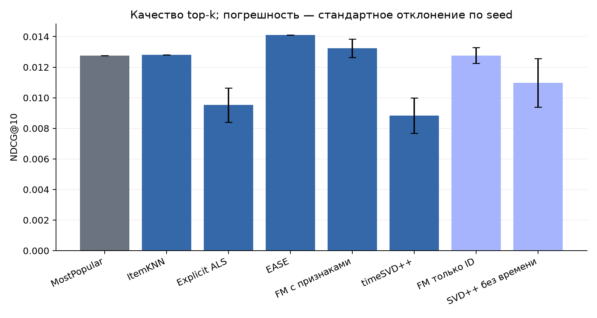
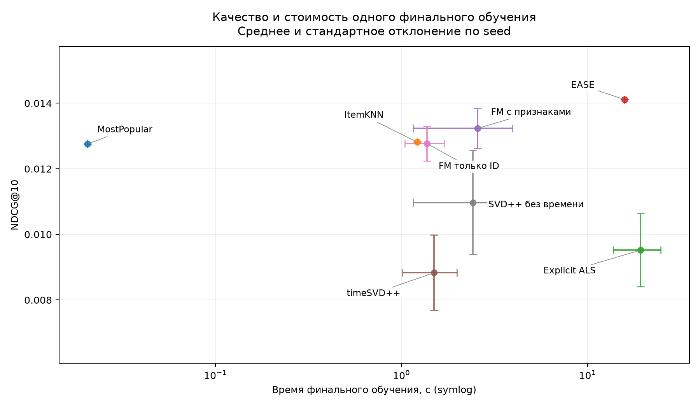

# Сравнение рекомендаций Amazon Musical Instruments 2018

Завершены все пять основных моделей и все финальные прогоны, предусмотренные конфигурацией.

## Данные и протокол

После очистки: 153,324 взаимодействий, 17,702 пользователей и 7,329 товаров. Отбор итеративного 5-core проводится только по train; для повторной пары пользователь–товар сохраняется самое раннее событие.

| Часть | Взаимодействия | Пользователи с положительной оценкой |
| --- | --- | --- |
| train | 144036 | 17667 |
| validation | 5547 | 2330 |
| test | 3741 | 1702 |

Границы UTC: train < 2017-04-17; validation от 2017-04-17 до 2017-12-08; test с 2017-12-08. Все события одного дня остаются вместе. Параметры и число эпох выбираются по validation, затем модель переобучается на train + validation. Test не участвует в подборе.

Основные метрики усредняются по 1702 пользователям с будущей оценкой ≥ 4 внутри каталога. Для каждого ранжируется весь каталог из 7329 товаров за вычетом всех уже оценённых товаров, включая оценки 1–3. Возвращается ровно 10 рекомендаций. При равных scores выбирается меньший внутренний item ID. При отсутствии персонального сигнала используется общий MostPopular fallback.

## Результаты

Среднее ± выборочное стандартное отклонение по seed. Для детерминированных методов выполнен один прогон, поэтому записанный ноль не является оценкой статистической неопределённости.

| Модель | Seed | NDCG@10 | Recall@10 | Precision@10 | MAP@10 |
| --- | --- | --- | --- | --- | --- |
| MostPopular | 1 | 0.01276 ± 0.00000 | 0.01822 ± 0.00000 | 0.00664 ± 0.00000 | 0.00945 ± 0.00000 |
| ItemKNN | 1 | 0.01282 ± 0.00000 | 0.02007 ± 0.00000 | 0.00529 ± 0.00000 | 0.00840 ± 0.00000 |
| Explicit ALS | 3 | 0.00952 ± 0.00112 | 0.01479 ± 0.00229 | 0.00360 ± 0.00038 | 0.00637 ± 0.00071 |
| EASE | 1 | 0.01411 ± 0.00000 | 0.02507 ± 0.00000 | 0.00570 ± 0.00000 | 0.00845 ± 0.00000 |
| FM с признаками | 3 | 0.01323 ± 0.00060 | 0.01893 ± 0.00075 | 0.00680 ± 0.00015 | 0.00943 ± 0.00060 |
| timeSVD++ | 3 | 0.00883 ± 0.00115 | 0.01279 ± 0.00079 | 0.00409 ± 0.00014 | 0.00519 ± 0.00132 |
| FM только ID | 3 | 0.01277 ± 0.00053 | 0.01856 ± 0.00102 | 0.00642 ± 0.00037 | 0.00883 ± 0.00042 |
| SVD++ без времени | 3 | 0.01097 ± 0.00159 | 0.01657 ± 0.00241 | 0.00541 ± 0.00077 | 0.00714 ± 0.00152 |

Наибольшее среднее тестовое NDCG@10 среди пяти основных методов в этом запуске получила модель EASE: 0.01411. Это описательное сравнение на выбранной когорте; вывод о превосходстве по всей популяции из него не следует.

## Парные сравнения

Основной заранее заданный контраст — timeSVD++ минус ALS. Для каждого пользователя сначала усредняются метрики по seed, затем одни и те же пользователи ресэмплируются для обеих моделей 2000 раз, seed 2026. Интервал — percentile bootstrap 95%. Seed-прогоны не считаются независимыми пользователями. Абляционные сравнения исследовательские; параметры наследуются от полной модели, а число эпох заново выбирается по validation.

| Разность | Роль | Δ NDCG@10 | 95% CI |
| --- | --- | --- | --- |
| timeSVD++ − Explicit ALS | primary | -0.00069 | [-0.00389; 0.00239] |
| timeSVD++ − SVD++ без времени | exploratory | -0.00214 | [-0.00387; -0.00071] |
| FM с признаками − FM только ID | exploratory | 0.00046 | [-0.00048; 0.00137] |

Сравнение timeSVD++ с ALS одновременно меняет временную модель и использование неявной истории. Для проверки вклада времени отдельно приведён SVD++ с отключёнными временными компонентами.

## Вычислительная стоимость

| Модель | Fit, с | Test scoring + метрики, с | Peak process RSS, МиБ |
| --- | --- | --- | --- |
| MostPopular | 0.038 ± 0.000 | 0.948 ± 0.000 | 449.5 ± 0.0 |
| ItemKNN | 1.214 ± 0.000 | 1.467 ± 0.000 | 517.6 ± 0.0 |
| Explicit ALS | 19.290 ± 5.499 | 1.168 ± 0.019 | 578.0 ± 29.4 |
| EASE | 15.803 ± 0.000 | 8.767 ± 0.000 | 1270.1 ± 0.0 |
| FM с признаками | 2.561 ± 1.400 | 1.030 ± 0.012 | 453.4 ± 5.3 |
| timeSVD++ | 1.500 ± 0.487 | 0.998 ± 0.004 | 473.4 ± 2.9 |
| FM только ID | 1.372 ± 0.328 | 0.944 ± 0.009 | 434.5 ± 0.7 |
| SVD++ без времени | 2.421 ± 1.261 | 0.998 ± 0.013 | 439.1 ± 1.3 |

Время относится к одному финальному refit и не включает весь поиск параметров. Peak RSS включает интерпретатор, библиотеки, данные и оставшиеся выделения процесса; это не размер параметров модели. RSS измеряется с интервалом 50 мс. Аппаратное окружение и число потоков находятся в provenance.json.

## Формулы метрик

Для пользователя u: Rᵤ — множество положительных test-товаров; hⱼ = 1, если рекомендация на позиции j входит в Rᵤ. Precision@10 = Σhⱼ/10; Recall@10 = Σhⱼ/|Rᵤ|. AP@10 = Σⱼ hⱼ·(Σₗ≤ⱼhₗ/j) / min(10, |Rᵤ|). DCG = Σⱼ hⱼ/log₂(j+1), NDCG = DCG/IDCG с идеальным размещением релевантных товаров. MAP и остальные основные метрики — среднее по пользователям с непустым Rᵤ.

## Ограничения и дополнительные проверки

Выборка описывает активных пользователей и фиксированный каталог. Она не оценивает cold-start и не представляет всех пользователей исходного Amazon. Outside-cohort не означает обязательно неизвестного на момент рекомендации пользователя или товара.

Доля положительных будущих событий выбранных пользователей, достижимых в каталоге, составляет 57.37%. Это micro-покрытие положительных событий, а не Recall модели. Recall_all_future@10 дополнительно учитывает в знаменателе товары вне каталога и включает пользователей с положительными оценками только вне каталога. Его среднее считается по другой явно указанной когорте.

FM использует только прошлые количества и средние оценки, возраст истории и известные календарные признаки. События текущего дня не входят в свои исторические признаки. timeSVD++ использует причинную адаптацию истории: только предыдущие дни; неизвестные user-day/item-bin поправки равны нулю. Названия из позднего metadata snapshot служат подписями и не являются историческими признаками модели.

В summary.csv также приведены покрытие каталога, популярность рекомендуемых товаров и доля fallback. activity_strata.csv содержит качество по числу train-взаимодействий (5–9, 10–19, 20+). list_overlap.csv показывает среднюю долю пересечения top-10 и Jaccard для seed 42. [Примеры рекомендаций](EXAMPLES.md) выбраны независимо от качества моделей.

## Воспроизводимость и аудит

Fingerprint эксперимента: `8e6355b37dd663e40544648b53b98227f3a23893f12717e3e12725ca59eab2c0`. Проверены контрольные суммы всех артефактов 18 финальных прогонов; основные метрики пересчитаны по сохранённым спискам. Исходные данные и веса моделей в публичный отчёт не копируются. В audit/ сохранены run.json, per-user метрики, рекомендации и журнал validation; audit/manifest.json содержит их SHA256. Внутренние целочисленные user ID оставлены для парной проверки, внешние reviewer ID и их отображение не публикуются. Хеш model.pkl внутри исходного run.json относится к локальному checkpoint.

Выбранные параметры: selected_parameters.json; полный бюджет и окружение: provenance.json; строки и правила подготовки: data_manifest.json. Все модели, scoring и top-k реализованы в src/recsys. Готовые обучаемые рекомендательные модели не используются.

## Источники

- [Amazon Reviews 2018, официальный источник](https://cseweb.ucsd.edu/~jmcauley/datasets/amazon_v2/)
- [EASE: Embarrassingly Shallow Autoencoders for Sparse Data](https://arxiv.org/abs/1905.03375)
- [Factorization Machines, авторский сайт](https://www.libfm.org/)
- [Collaborative Filtering with Temporal Dynamics](https://cseweb.ucsd.edu/classes/fa17/cse291-b/reading/p447-koren.pdf)
- [On Sampled Metrics for Item Recommendation](https://research.google/pubs/on-sampled-metrics-for-item-recommendation/)
